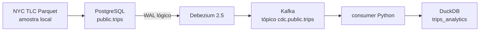

# CDC Real-Time — PostgreSQL, Debezium e Kafka

Protótipo local de Change Data Capture com PostgreSQL 16, Debezium, Kafka e um consumidor Python que grava eventos de criação no DuckDB.

**Estado:** prova de conceito parcial. A infraestrutura e o caminho de `INSERT` estão implementados; UPDATE, aplicação de DELETE no destino, idempotência, testes e recuperação de offsets ainda não estão concluídos.

## Problema

Recarregar tabelas inteiras aumenta trabalho no banco de origem e latência. CDC lê mudanças do WAL do PostgreSQL e as publica como eventos incrementais.

## Fluxo implementado



O produtor insere a amostra linha a linha no PostgreSQL. O consumidor trata eventos Debezium com operação `c` e insere cinco campos no DuckDB; eventos `d` são apenas registrados no log. Não há ramo para `u`.

## Pré-requisitos

- Python 3.10+;
- Docker com Compose;
- acesso à internet para baixar a amostra NYC TLC;
- um arquivo `.env` local, não versionado.

Variáveis usadas pelo código:

```dotenv
DB_HOST=localhost
DB_PORT=5432
DB_NAME=nyctaxi
DB_USER=user
DB_PASSWORD=password
KAFKA_BOOTSTRAP_SERVERS=localhost:9092
KAFKA_TOPIC=cdc.public.trips
DUCKDB_PATH=data/cdc.duckdb
```

## Executar

```bash
python -m venv .venv
# Windows: .venv\Scripts\activate
# Linux/macOS: source .venv/bin/activate
pip install -r requirements.txt
python src/producer/extract_sample.py
python run.py
```

`run.py` sobe o Compose, espera o Debezium, registra o connector, inicia consumidor e produtor e encerra o consumidor quando a carga termina. O script não derruba os containers automaticamente.

Para inspecionar o destino, use `notebook/check_data_duckdb.ipynb` ou consulte `trips_analytics` diretamente no arquivo configurado.

## Verificações e limites

- não há suíte automatizada;
- a sintaxe Python foi compilada na auditoria local, sem executar Docker ou o fluxo end-to-end;
- o consumer não define `group_id` nem chave única e pode duplicar linhas em reprocessamentos;
- UPDATE não é aplicado e DELETE não remove dados do DuckDB;
- não há tratamento de tombstones, evolução de schema, DLQ ou retries explícitos;
- credenciais do Compose são apenas valores locais de demonstração.

Próximos passos coerentes: definir a semântica do destino, implementar UPSERT/DELETE idempotentes, persistir offsets por grupo e adicionar um teste end-to-end para INSERT, UPDATE, DELETE e reinício do consumer.
